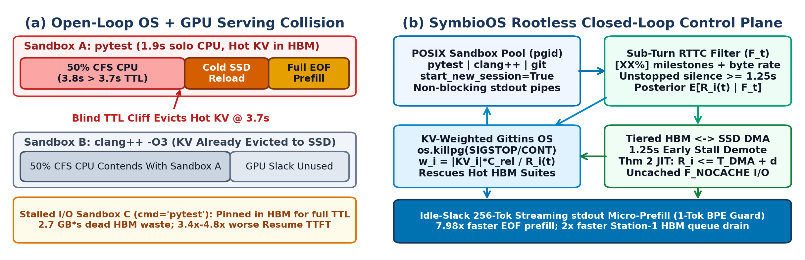
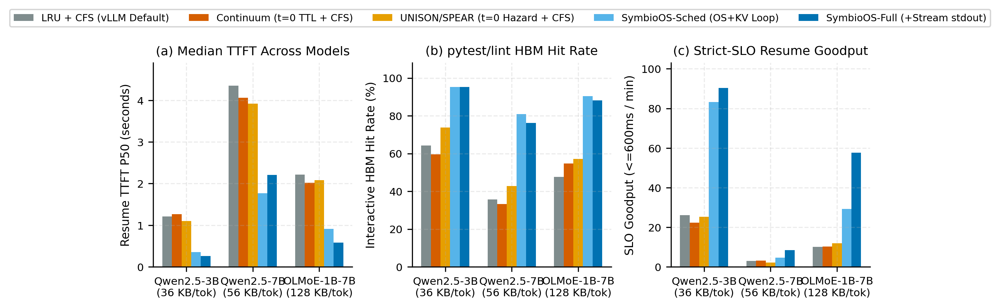

# SymbioOS: Closed-Loop Rootless POSIX Sandbox Scheduling and White-Box Streaming KV Promotion for Tool-Intensive Agent Clusters

[](LICENSE)
[](https://huggingface.co/datasets/batistado/SymbioBench-Agent)
[](https://huggingface.co/spaces/batistado/SymbioOS-Explorer)
[](https://huggingface.co/batistado/SymbioOS)

`SymbioOS` is a rootless user-space control plane that closes the scheduling and memory-tiering loop between host POSIX developer-tool sandboxes (`pytest`, `clang++`, `git`) and GPU Key-Value (KV) cache tiers during multi-turn coding-agent execution.

* **Benchmark Dataset (`2,168` real hardware resumes + `256`-sandbox cluster sweeps):** [`huggingface.co/datasets/batistado/SymbioBench-Agent`](https://huggingface.co/datasets/batistado/SymbioBench-Agent)
* **Interactive Explorer Space (`sdk: static`):** [`huggingface.co/spaces/batistado/SymbioOS-Explorer`](https://huggingface.co/spaces/batistado/SymbioOS-Explorer)
* **System & Artifact Hub:** [`huggingface.co/batistado/SymbioOS`](https://huggingface.co/batistado/SymbioOS)
* **Manuscript Source & Overleaf Bundle:** [`paper/main.tex`](paper/main.tex) and [`paper/symbioos_tpds_overleaf.zip`](paper/symbioos_tpds_overleaf.zip)

---

## Architecture Overview



1. **White-Box Sub-Turn Pipe Filtration (`SubTurnRTTCFilter`):** Tracks non-blocking `stdout` milestones (`[XX%]`), byte velocity, and *unstopped-quantum silence* (`!is_sigstopped`) to separate socket/lock hangs (`1.25s` early demotion) from CPU-throttled startup imports with zero false evictions.
2. **Rootless POSIX Process-Group Gittins Priority (`KVWeightedGittinsScheduler`):** Schedules entire tool process trees (`setsid` / `os.killpg` `SIGSTOP`/`SIGCONT`) by $w_i(t) \propto |KV_i|\cdot C_{\text{rel}} / \hat{R}_i(t)$, rescuing hot HBM test suites from contention-induced TTL cliffs, paired with **Theorem 2 Optimal-Stopping JIT Promotion** (`OptimalStoppingJITController`).
3. **Exact Streaming `stdout` Micro-Prefill (`LookbackBPEStreamer`):** Harvests idle GPU slack while tools are still running to pre-encode `256`-token chunks guarded by a 1-token BPE lookback holdout, preserving exact token-ID and logit equivalence (`cos_sim = 0.999997`, `0.0` max diff) while shrinking post-exit prefill by **`7.98x`** and draining Station-1 HBM queues **`~2x`** faster.

---

## Headline Results (`2,168` Real Hardware Resumes + `N = 256` Scale-Out Sweeps)



- **Multi-Architecture Real DevTools (`pytest 9.2` + `clang++ -O3` + `git` via `os.killpg`):**
  - `Qwen2.5-3B-Instruct` (`36 KB/tok` Dense GQA): **`4.6x–4.8x`** lower median Resume TTFT (`1,209.6–1,265.7 ms` $\to$ **`262.6 ms`**), **`95.2%`** interactive HBM hit rate, **`3.5x–4.1x`** higher `<=600 ms` SLO goodput (`90.4` vs. `22.2–26.1 /min`).
  - `Qwen2.5-7B-Instruct` (`56 KB/tok` Dense GQA): **`2.2x–2.5x`** lower median TTFT (`3,918–4,355 ms` $\to$ **`1,765.1 ms`**), **`81.0%`** interactive HBM hit rate, **`+20.0%`** raw episode goodput, **`2.6x–4.0x`** higher SLO goodput.
  - `OLMoE-1B-7B-0924-Instruct` (`128 KB/tok` Sparse MoE MHA): **`3.5x–3.8x`** lower median TTFT (`2,021.5–2,216.3 ms` $\to$ **`580.9 ms`**), **`88.1%–90.5%`** interactive hit rate, **`+21.6%`** raw goodput, **`4.8x–5.7x`** higher SLO goodput (`57.6` vs. `10.1–11.9 /min`).
- **Cluster Scale-Out (`N = 128`, Tight `15%`–`25%` HBM):** **`5.80x`** lower median TTFT at `15%` HBM (`3,701.9 ms` $\to$ **`638.1 ms`**) and **`3.85x`** lower at `25%` HBM (`506.6 ms` $\to$ **`131.7 ms`**).

---

## Quick Install & Verification

```bash
pip install -e .
pytest -v tests/
```

### Reproduce Benchmarks & Figures
```bash
# Phase 0 Controlled Multi-Container MPS Pilot
python pilot/symbioos_pilot.py --seeds 42,137,2026

# Phase 1 Real pytest 9.2 + clang++ -O3 + git Across 3 LLM Architectures
python pilot/phase1_multimodel_devtools.py --seeds 42,137 --max-concurrency 10 --cpu-cores 3

# Phase 2 Cluster Scale-Out (N = 32..256) Coupled Tandem-Queue Sweeps
python pilot/phase2_tandem_simulator.py

# Regenerate Vector PDF + 300-DPI PNG Figures & Validate IEEE TPDS Manuscript
python scripts/generate_paper_figures.py
python paper/validate_latex.py
```

---

## Citation

```bibtex
@article{syed2026symbioos,
  title   = {{SymbioOS}: Closed-Loop Rootless {POSIX} Sandbox Scheduling and White-Box Streaming {KV} Promotion for Tool-Intensive Agent Clusters},
  author  = {Syed, Mohammed Kamran and Rentala, Anudeep and Rahul, Somesh and Pai, Raghuram Malpe and Dara, Krishna Suman},
  journal = {IEEE Transactions on Parallel and Distributed Systems (TPDS)},
  year    = {2026},
  url     = {https://github.com/batistado/symbioos}
}
```
